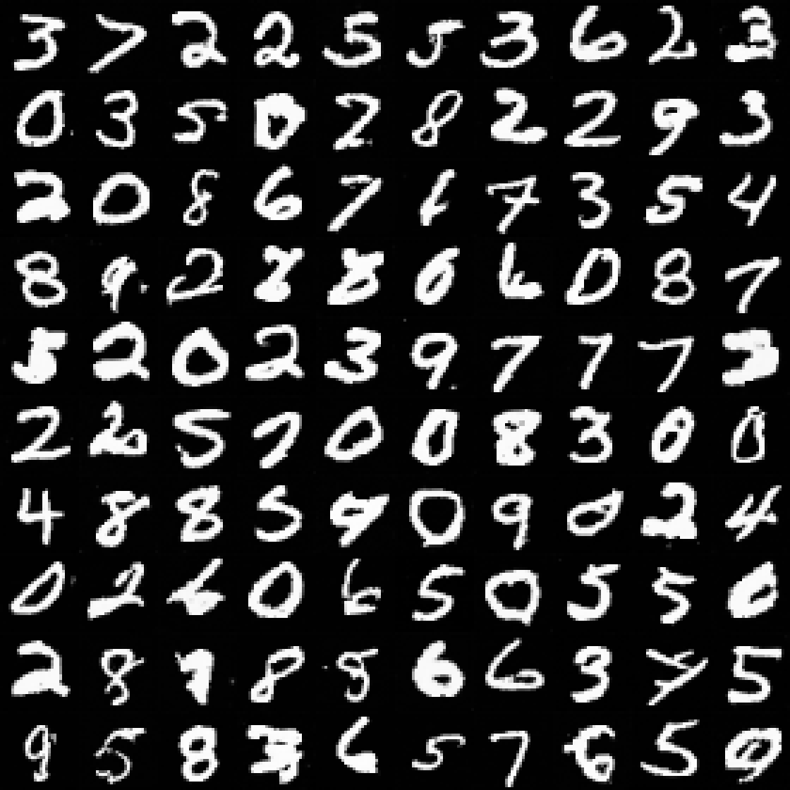
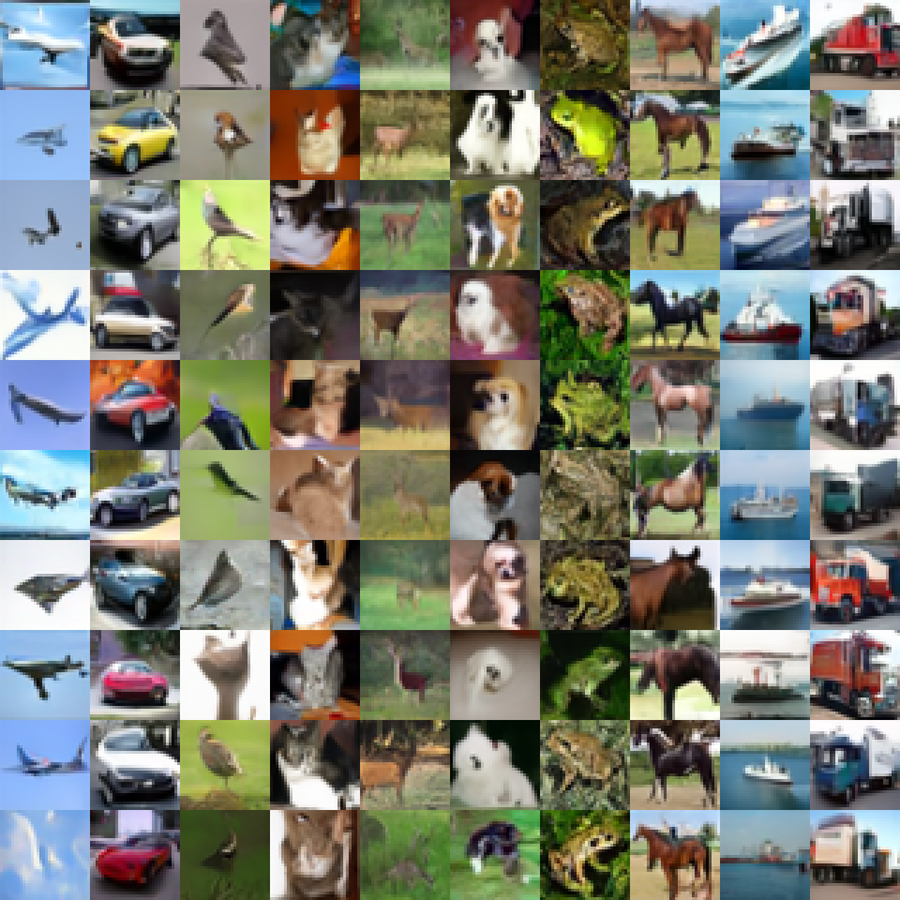

# Image Reconstruction: Diffusion and Autoencoders

An older CS 472 (unsupervised learning) course project in PyTorch. It trains DDPM diffusion models on MNIST and CIFAR-10, with autoencoder, denoising autoencoder, and variational autoencoder baselines on MNIST.

**[Samples and results →](https://kalebcoleman.github.io/ImageReconstruction/)**

| MNIST diffusion samples | CIFAR-10 diffusion samples |
|---|---|
|  |  |

## Diffusion

Two models, each trained from scratch and sampled with 50 DDIM steps:

- **MNIST:** 28x28 grayscale, a small U-Net, 500 timesteps on a linear schedule, noise prediction.
- **CIFAR-10:** 32x32 RGB, an ADM-style U-Net with attention, 1,000 timesteps on a cosine schedule, v-prediction, EMA, and class conditioning with classifier-free guidance.

```bash
python train.py --config configs/diffusion/mnist.yaml
python train.py --config configs/diffusion/cifar10.yaml
```

A run writes its checkpoints, metrics, loss curve, reverse-process snapshots, and sample grids to `outputs/<dataset>/diffusion/<run_name>/`. Slurm jobs for GPU runs are in [`slurm/final_study/`](slurm/final_study/):

```bash
sbatch slurm/final_study/smoke_array.slurm
sbatch slurm/final_study/train_mnist_array.slurm
sbatch slurm/final_study/train_cifar10_array.slurm
```

The sample grids are shown as generated; no quantitative sample-quality metric such as FID is reported.

## Autoencoder baselines

```bash
python train.py --model ae --dataset mnist --latent-dim 16
python train.py --model dae --dataset mnist --latent-dim 16 --dae-noise-level 0.2
python train.py --model vae --dataset mnist --latent-dim 16
python train.py --models ae dae vae --dataset mnist --latent-dim 16   # all three
```

`--dataset fashion` runs the same models on Fashion-MNIST. Outputs go to `outputs/<dataset>/<model>/<run_name>/`.

## Layout

```text
diffusion/                 DDPM models, schedulers, DDIM sampling, training
configs/diffusion/         mnist.yaml and cifar10.yaml
autoencoders/              AE, DAE, VAE models, training, metrics, plots
slurm/final_study/         Slurm jobs for the diffusion runs
scripts/collect_report_assets.py   copies final figures into docs/assets/
docs/                      GitHub Pages site
train.py                   training entry point
```

Generated folders such as `data/`, `outputs/`, `runs/`, and `checkpoints/` are ignored by git.

## Scope

This is coursework on small benchmark datasets, kept as a record. The course project also planned a PCA comparison done by a teammate. That part is not in this repository, so no PCA-versus-autoencoder conclusions are drawn here.

## License

MIT, see [LICENSE](LICENSE).
