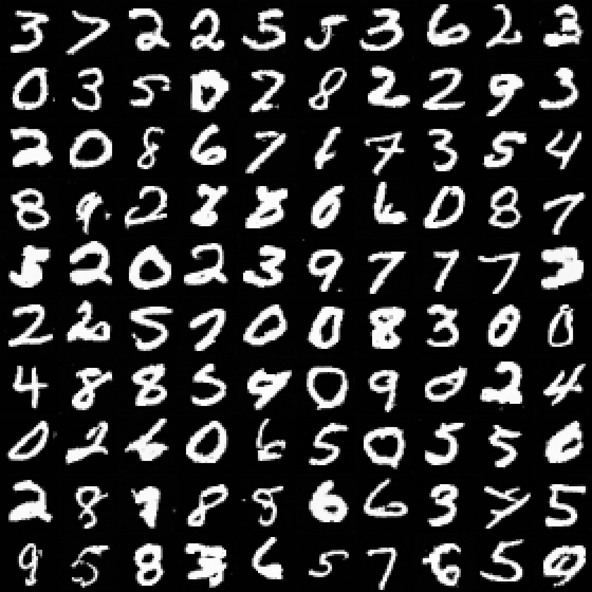
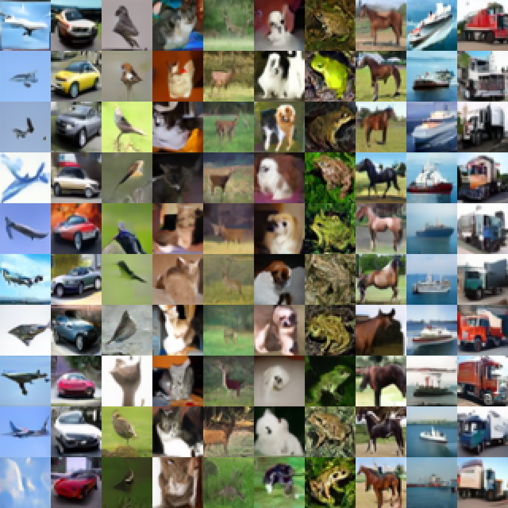
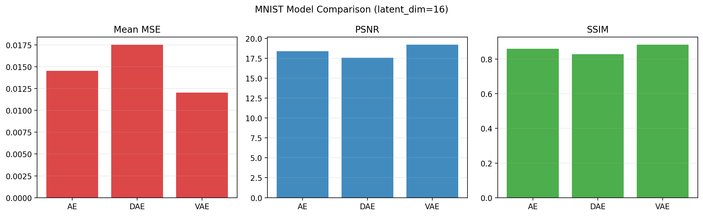
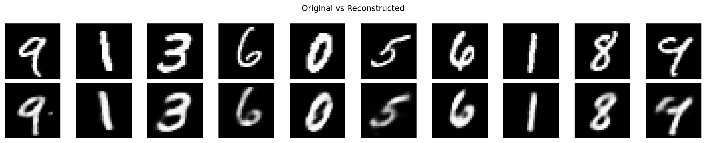
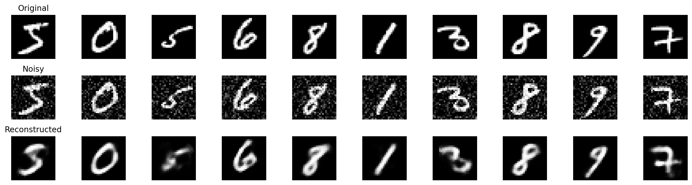
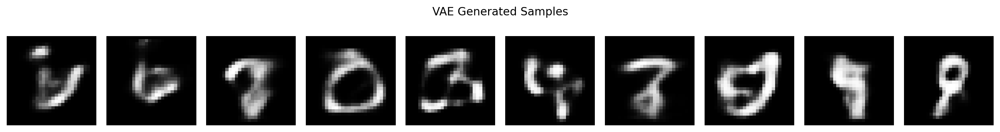

# Diffusion and Autoencoder Image Models

<link rel="stylesheet" href="./style.css">

An older CS 472 (unsupervised learning) course project. It trains DDPM diffusion models on MNIST and CIFAR-10, with autoencoder, denoising autoencoder, and variational autoencoder baselines on MNIST. Code: [github.com/kalebcoleman/ImageReconstruction](https://github.com/kalebcoleman/ImageReconstruction).

## Diffusion

Both models are trained from scratch and sampled with 50 DDIM steps. The settings below are the ones in the repository's configs.

| | MNIST | CIFAR-10 |
|---|---|---|
| Image size | 28x28 grayscale | 32x32 RGB |
| Network | small U-Net | ADM-style U-Net with attention at 8x8 |
| Timesteps and schedule | 500, linear | 1,000, cosine |
| Prediction target | noise (epsilon) | v-prediction |
| Conditioning | none | class labels with classifier-free guidance (scale 3.0) |
| Training length | 50 epochs | 150 epochs, EMA 0.999 |

The grids below are generated samples, enlarged 4x with nearest-neighbor scaling so the browser does not blur them. The samples are shown as generated; no quantitative sample-quality metric such as FID is reported here.

### MNIST samples



### CIFAR-10 samples

Each column is one class.



## Autoencoder baselines

Three models reconstruct MNIST digits through a 16-dimensional latent space: a regular autoencoder (AE), a denoising autoencoder (DAE) trained on inputs with noise level 0.2, and a variational autoencoder (VAE).



Autoencoder reconstructions:



Denoising autoencoder, reconstructing from noisy inputs:



Samples drawn from the VAE's latent distribution:



## Scope

This is coursework on small benchmark datasets, kept as a record. The course project also planned a PCA comparison done by a teammate. That part is not in this repository, so no PCA-versus-autoencoder conclusions are drawn here.

## Reproduce

```bash
pip install -r requirements.txt

# Diffusion
python train.py --config configs/diffusion/mnist.yaml
python train.py --config configs/diffusion/cifar10.yaml

# Autoencoder baselines
python train.py --models ae dae vae --dataset mnist --latent-dim 16
```
